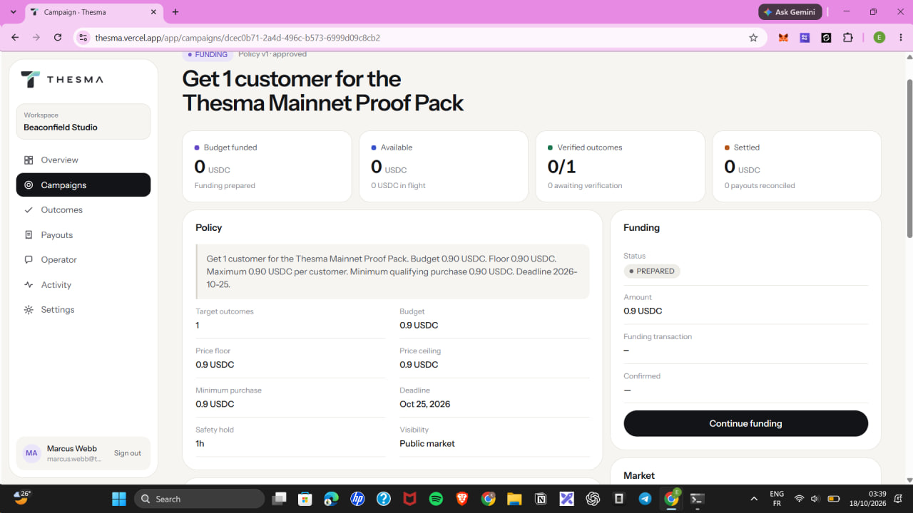
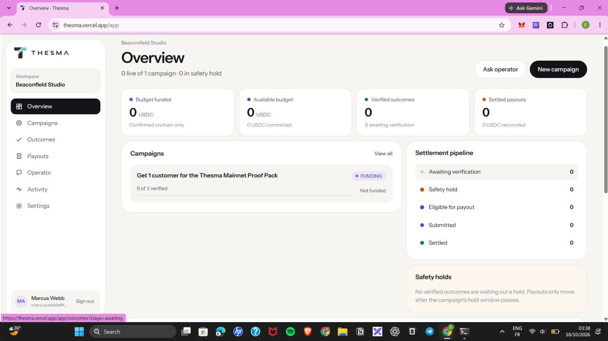
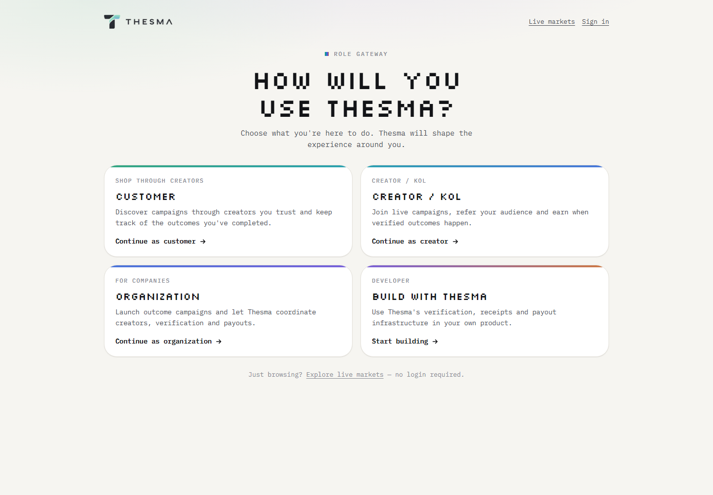
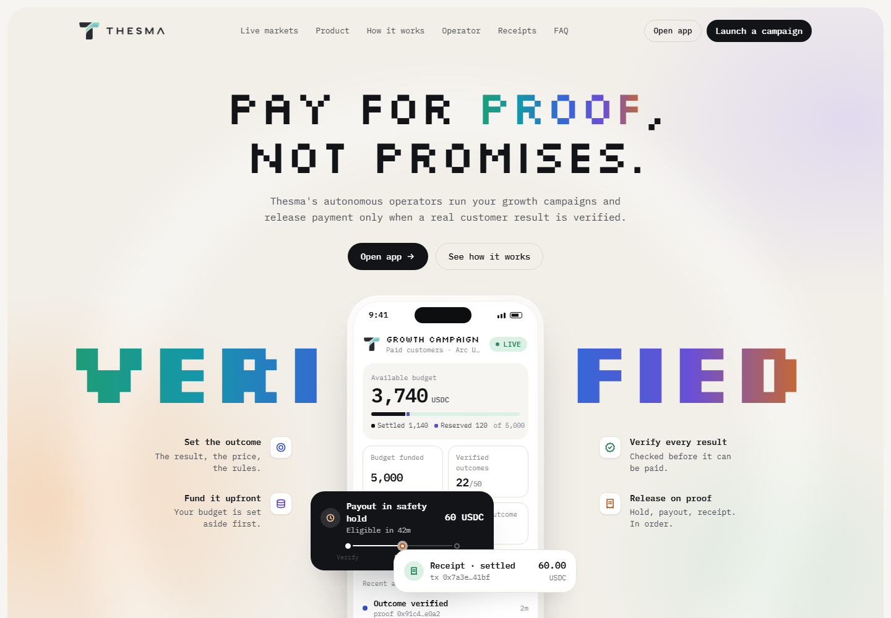
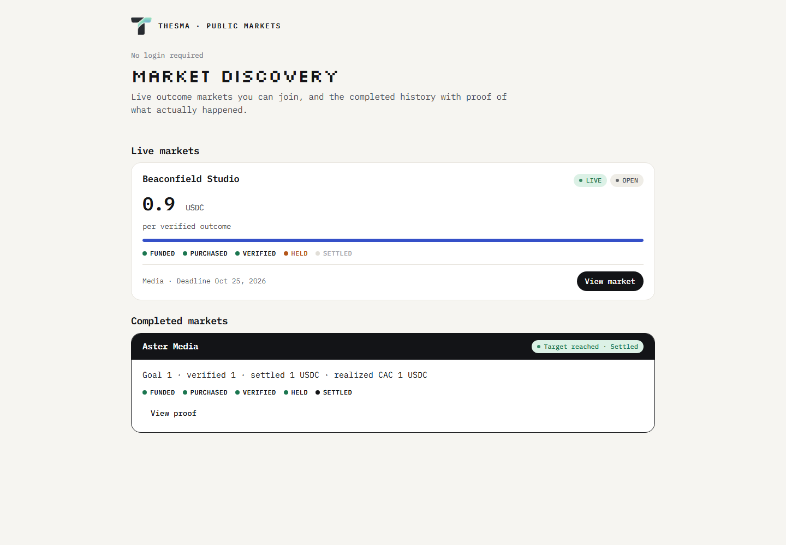
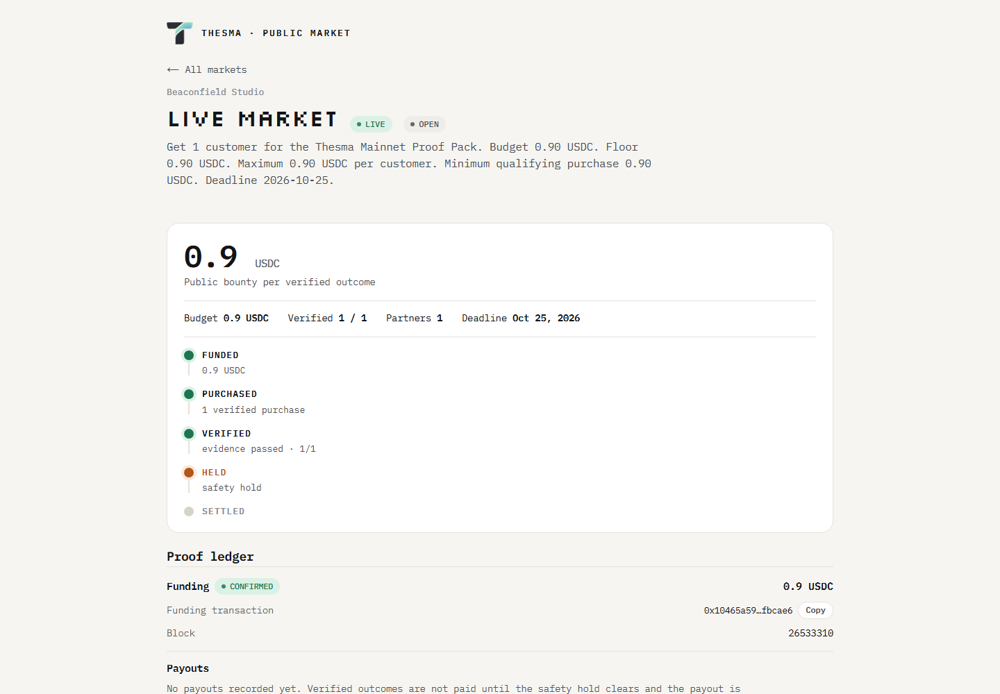
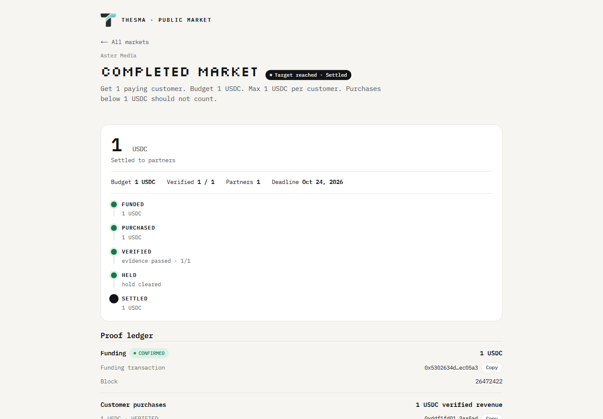

<div align="center">

<p align="center">
  
</p>

<h1>THESMA</h1>

<p><strong>Autonomous operators for outcome based campaigns.</strong></p>

<p><em>Pay only for verified results.</em></p>

<p>Businesses define the outcome, budget and rules. Thesma coordinates campaign execution, verification and settlement so money moves only when proof, policy and budget agree.</p>

<p><code>INTENT → POLICY → PROOF → SETTLEMENT</code></p>

<p>
<a href="https://thesma.vercel.app"></a>
<a href="docs/mainnet-proof.md"></a>
</p>

<p>


</p>

<p><sub>Tameion Hackathon · RFB 04: Autonomous Business Operator</sub></p>

<p>
<a href="https://thesma.vercel.app">Website</a> ·
<a href="docs/mainnet-proof.md">Mainnet Proof</a> ·
<a href="#how-thesma-works">How It Works</a> ·
<a href="#technical-architecture">Architecture</a> ·
<a href="#local-setup">Local Setup</a>
</p>

</div>

---

## Judge quick links

| Area | Link |
| --- | --- |
| Live app | [thesma.vercel.app](https://thesma.vercel.app) |
| Public markets | [thesma.vercel.app/markets](https://thesma.vercel.app/markets) |
| Security | [thesma.vercel.app/security](https://thesma.vercel.app/security) |
| Thesma on X | [x.com/usethesma](https://x.com/usethesma) |
| Builder (Kaelah) on X | [x.com/_kaaelaa_](https://x.com/_kaaelaa_) |
| Arc testnet operator proof | [`docs/proof/operator-testnet.md`](docs/proof/operator-testnet.md) |
| Beaconfield live proof | [market `dcec0b71…`](https://thesma.vercel.app/markets/dcec0b71-2a4d-496c-b573-6999d09c8cb2) |
| Aster settled proof | [market `5571f328…`](https://thesma.vercel.app/markets/5571f328-ceeb-4712-8671-a72be1966ffb) |

---

## Build in public

Concise social proof — official accounts and representative posts:

- Builder: Kaelah — [x.com/_kaaelaa_](https://x.com/_kaaelaa_)
- Builder update #1 — [View post](https://x.com/_kaaelaa_/status/2111955196238803027)
- Builder update #2 — [View post](https://x.com/_kaaelaa_/status/2112081428515315777)
- Thesma official — [x.com/usethesma](https://x.com/usethesma)
- Thesma update #1 — [View post](https://x.com/usethesma/status/2112083441479250314)
- Thesma update #2 — [View post](https://x.com/usethesma/status/2111837615213400366)
- Thesma update #3 — [View post](https://x.com/usethesma/status/2111584169046503553)
- Thesma update #4 — [View post](https://x.com/usethesma/status/2111559308387156072)

---

## Live production usage

On October 18, 2026, a user-operated production run took a fresh Thesma campaign from approved policy to LIVE on Arc Mainnet through the deployed web app and MetaMask — not a script-only chain call.

- Workspace: Beaconfield Studio
- Campaign: `dcec0b71-2a4d-496c-b573-6999d09c8cb2`
- Budget funded: **0.90 USDC** (900,000 micro-USDC)
- Register campaign: `0x09fed70acc01a01db5a338226d58bafd5664cc485aa5663711a634682c1c9377`
- Approve USDC: `0xd0ee24f7acf0c0689efb633f00da19b66c0cbf0ec1ac70f1281b7f8a07d92006`
- Fund campaign: `0x10465a59d6fc5309fc8220a04f0af9f81d8bd564def54d567502328842fbcae6`
- Reconciled product state: **LIVE**, funding **CONFIRMED**, funded **900000**, spent **0**

The owner signed each transaction in the Thesma UI. Thesma moved the campaign to LIVE only after independently reading Arc and matching the expected onchain funding state.

This run is intentionally separate from the canonical completed lifecycle below. Run #1 already completed:

customer purchase → deterministic verification → legitimate 1-hour safety hold → partner payout → independent onchain reconciliation → SETTLED.

This demonstrates both:
1. a fresh user-operated campaign can be launched through the production product;
2. the canonical full lifecycle has already settled successfully on Arc Mainnet.

### Proof #2: real customer purchase, VERIFIED in hold

The same production campaign then processed a real public customer checkout through the deployed app — no Thesma account required. The customer connected a wallet, signed the exact USDC transfer in MetaMask, and the backend verified it by independently reading Arc.

- Partner: Jordan Lee (`0007a280-d3fd-4872-ab2e-146c5d045681`), terms `7d253855-19f2-4847-8c99-c29883c756ca`, referral `GQzyC4jPnMAy`
- Checkout intent: `4779e772-f62a-4926-ae4d-59ecd894f5e0`, order `ord_f4d98886bfe9194d365cb5c4`
- Purchase tx: `0x0b967b216d8eada977d1fd738425a40bda490a2daaeca335fde0e500ba2c0812` (receipt `success`, block `26548564`)
- Customer: `0x15b8605e7ce72E114aBeAF1D8b3315C0874B53E7`, merchant: `0x51c63A4bcF8E622D686bF1D7ec5ae5b77D50E677`, amount **0.90 USDC** (900,000 micro-USDC; decoded onchain recipient and amount match exactly)
- Outcome: `5fb1e592-0a87-4bcf-a502-9cdb98cb295d`, status **VERIFIED**, proof hash `0xdc0f207f682623e0f05165262cfa63d8ea4cd6a3b5884feb7ce82e16018a0fd7`
- Verified: `2026-10-18T04:50:26.889Z`; safety hold **3600 seconds** until `2026-10-18T05:50:26.889Z` (06:50:26 Nigeria time)

At the time of writing, Proof #2 is VERIFIED and serving its legitimate safety hold. It is NOT settled: no reservation, no payout, and no `OutcomePaid` event exist for this outcome. Run #1 remains the canonical completed SETTLED lifecycle.

### Fresh campaign through the production UI

Screenshots captured immediately before Proof #2 funding — the campaign waiting in FUNDING with zero funded/settled state, not the later LIVE/VERIFIED state.

<table>
  <tr>
    <td width="50%"><br /><sub><strong>Campaign detail (pre-funding)</strong> — approved 0.90 USDC policy, 1h safety hold, and the owner-side "Continue funding" flow before mainnet activation.</sub></td>
    <td width="50%"><br /><sub><strong>Overview (pre-funding)</strong> — fresh production workspace with zero funded/settled state; the campaign waiting in FUNDING.</sub></td>
  </tr>
</table>

---

## Proof at a glance

Thesma completed the full real lifecycle on **Arc Mainnet (chain ID 5042)**. Full canonical evidence: [`docs/mainnet-proof.md`](docs/mainnet-proof.md). All hashes/addresses below are public onchain data.

- **FUNDED** — exactly **1.00 USDC** of campaign funding on Arc Mainnet (tx `0x5302634da4500b29338a14739917aff66d22e902f1d8dcf910f91a4f1cec05a3`, CONFIRMED 1,000,000 / 1,000,000 micro-USDC).
- **PURCHASED** — one real customer purchase, payer → company, tx `0xddf1fd01f815b69c5e30487d2916c6e91186f58af293fd38b5bfef15473aa5ad`.
- **VERIFIED** — deterministic outcome verification succeeded (`2026-10-17T19:48:17.123Z`), proof hash `0xca8a726ab92366eade1acd4186e5aa01e9b120e94a5da18eb6587e5703a8c9e2`.
- **HELD** — legitimate **3600-second** safety hold enforced before any payout became eligible.
- **SETTLED** — exactly **1.00 USDC** partner payout submitted once (tx `0xec3ab9e2bd8ad1ce1412fc0c2c4a65897dc598ddc221c3ef18cd148f350cb6b0`) and reconciled against the matching onchain `OutcomePaid` event.
- **NO DOUBLE PAY** — a second worker run settled 0 and submitted 0 with reason `ALREADY_SETTLED`: no second reservation, no second payout, no second transaction.

## How Thesma works

A business describes its intent in plain language. Thesma turns it into a typed campaign policy, funds it onchain, and then enforces the policy end to end:

`business intent → typed campaign policy → campaign funding → partner participation → customer outcome → deterministic verification → safety hold → payout reservation → signed submission → independent reconciliation → settled receipt`

What this guarantees:

- **Arc Mainnet is live and proven.** The canonical lifecycle above ran on chain 5042 against the deployed `ThesmaMarketVault` (`0x0fA826256a58F19Ad24Fc9384d81D313f2266F79`).
- **USDC settlement is real.** Exactly 1,000,000 micro-USDC moved from funded budget to partner wallet, matched event-for-event onchain.
- **Payout authority is policy-bound.** The company grants payout authority when it funds a campaign inside hard limits (budget, floor, ceiling, deadline). No per-payout approval exists — and none is needed, because the worker can only pay what the frozen policy allows.
- **Duplicate settlement is structurally impossible.** One reservation and one payout per outcome for life (unique constraints), plus a second-run `ALREADY_SETTLED` proof.
- **Outcome proof is EIP-712.** The verifier signs the exact outcome proof; the executor submits once; reconciliation independently matches the `OutcomePaid` event before anything is called settled.
- **Signing responsibilities stay separated.** Campaign funding is signed by the owner in their own browser wallet (the backend only prepares unsigned intents and verifies receipts). Payout submission and outcome-proof signing run through isolated backend executor/verifier roles bound into each campaign — and the backend refuses to start unless those keys derive to the configured addresses.
- **The Operator explains; rules authorize.** The in-app Operator answers deterministically over the live workspace snapshot. Financial authorization comes only from the deterministic kernels and onchain reconciliation — an LLM never decides a payout.

What Thesma does **not** claim: Circle Gateway, CCTP, x402, Circle Wallets / App Kit / Agent Stack, paymasters, fiat ramps, or LLM-decided payouts.

## Who Thesma serves

Thesma is multi-sided. Opening the app routes into a role gateway (`/start`) — **How will you use Thesma?** — and the choice shapes onboarding and home. Returning users with finished onboarding skip the gateway.

<p align="center">
  
</p>

- **Customer** — discover campaigns through creators you trust and keep track of the outcomes you've completed. Light onboarding; home has *For you*, *Creators you follow*, *Your activity* (real data or honest empty states — never fake history).
- **Creator / KOL** — join live campaigns, refer your audience and earn when verified outcomes happen. Onboarding captures display name plus optional public handle (reserved for a future `/@username` profile), bio and niche — never self-reported follower counts. Creator home shows live campaigns, referrals, verified outcomes and settled earnings from real tables only.
- **Organization** — account → workspace/company → campaign creation. Workspace onboarding lives at `/onboarding/organization`; once a workspace exists, `/app/campaigns/new` is purely campaign creation. The `/app` workspace keeps the full product below.
- **Build with Thesma** — use Thesma's verification, receipts and payout infrastructure in your own product. Developer onboarding explains connect → send outcomes → verify → receipts → payouts; API keys/webhooks are truthful empty states until the developer preview opens.

The persona is onboarding context, not authorization: workspace/partner access still comes only from membership checks. Public `/markets` never requires login.

## Product

Live production UI at [thesma.vercel.app](https://thesma.vercel.app) — every screenshot below is the real rendered product, captured October 2026.

<p align="center">
  
</p>

### Creator distribution loop

Join campaign → unique referral link → customer action → attribution → verification → hold → settlement. Creators join live campaigns from their home, copy a stable `/r/[code]` link, and watch a real funnel: clicks, conversions, verified outcomes, holds, settled payouts. No fake metrics — empty stages show 0. (Creator home and campaign workspace require sign-in, so they are described here rather than screenshotted.) Public `/@username` creator profiles and follow are not shipped yet — creator identity appears on onboarding, the creator home, and referral landings.

### Organization operations

Account → workspace → campaign creation, then the `/app` workspace: funded vs committed vs available budget, outcomes truthfully stated, reservation → submission → reconciliation payouts, receipts, activity, and a per-participant funnel on each campaign. (Workspace views require sign-in.)

### Public evidence ledger

<p align="center">
  
</p>

 Beaconfield Studio live at 0.9 USDC per verified outcome with the lifecycle stopping truthfully before SETTLED; Aster Media below it as the permanent completed record.

### Live truth — Beaconfield

<p align="center">
  
</p>

Campaign `dcec0b71-2a4d-496c-b573-6999d09c8cb2`: LIVE, funded 0.9 USDC CONFIRMED, 1 verified purchase, serving its safety hold — **verified/held is not settled**: "No payouts recorded yet."

### Permanent proof — Aster

<p align="center">
  
</p>

Campaign `5571f328-ceeb-4712-8671-a72be1966ffb`: Target reached · Settled, full lifecycle FUNDED → PURCHASED → VERIFIED → HELD → SETTLED, 1 USDC reconciled against the onchain `OutcomePaid` event.

**VERIFIED != PAID · SUBMITTED != SETTLED** — documented and enforced everywhere above.

### Public proof

`/markets` needs no login: LIVE markets (PUBLIC + LIVE + OPEN + unexpired) plus a permanent completed history that stays visible after close/expiry with factual results only — goal, final state, verified outcomes, spend, verified revenue and realized CAC when computable. `/markets/[campaignId]` is the judge-proof detail: terms, progress, agent decisions, funding state, and for completed markets payouts, receipts and Arc explorer links where available. PRIVATE campaigns never leak.

Lifecycle: `FUNDED → PURCHASED → VERIFIED → HELD → SETTLED`. Two rules hold everywhere in the product: **VERIFIED != PAID** (evidence passed, money has not moved) and **SUBMITTED != SETTLED** (a payout transaction exists, independent `OutcomePaid` reconciliation has not confirmed it). Only reconciliation settles.

### Product surfaces

The live app gives each workspace:

- **Overview** — funded vs committed vs available budget per campaign.
- **Campaigns** — draft, review, approve, fund, and open markets within policy bounds.
- **Outcomes** — every customer outcome with truthful state: `PENDING`, `VERIFIED` (evidence passed — **not** paid), `REJECTED`.
- **Payouts** — reservation → submission → reconciliation states; `SUBMITTED` is never called settled.
- **Receipts** — human-readable payout receipts with live-recomputed checks (funded, terms match, wallet match, hold) and a truthful `settledMeansReconciled` flag.
- **Activity** — append-only audit trail of who did what, when.
- **Operator** — deterministic answers over live workspace state (status, holds, budget, verified outcomes, receipts).
- **Owner funding** — connect MetaMask → register campaign → approve USDC → fund → independent onchain confirmation → LIVE. Recorded funding steps are never blindly resent; submitted/ambiguous funding state reconciles first.
- **Public checkout** — `/buy/[attributionHandle]` with no Thesma account required. Wallet safety is enforced before signing (correct Arc chain, payer ≠ merchant, payer ≠ partner payout wallet, balance check) and the backend validates the exact unsigned USDC transfer; the browser only submits the tx hash and the server mints `VERIFIED` from canonical Arc evidence only, with the 1h safety hold shown to the customer. Prepared/submitted checkout state survives refresh with no duplicate intent or payment resend.
- **Automatic payouts** — `processEligiblePayouts()` scans `VERIFIED` outcomes: hold-active outcomes are skipped, expired holds follow reserve → submit once → reconcile `OutcomePaid` → `SETTLED`, settled outcomes are skipped, and submitted/ambiguous payouts reconcile before any resend. No per-payout user approval or manual prompt is required. Vercel Cron invokes the same worker via `GET /internal/payouts/process` (the existing authenticated trigger remains `POST`); the current Hobby deployment runs this cron daily as a production backstop, while the worker itself supports higher-frequency invocation without code changes.
- **Public market discovery** — `/markets` needs no login: LIVE markets (PUBLIC + LIVE + OPEN + unexpired) plus a completed history that stays visible after close/expiry with factual results only (goal, final state, verified outcomes, spend, verified revenue and realized CAC when computable — never fabricated). `/markets/[campaignId]` shows the judge-proof detail: terms, progress, agent decisions, funding state, and for completed markets payouts, receipts and Arc explorer links where available. PRIVATE campaigns never leak.
- **Supply Agent onboarding** — `/app/agent` starts from one question ("What kinds of outcome markets should I watch for you?") and progressively gathers minimum bounty, auto-join/auto-negotiate and caps. Answers become typed `PartnerRules` (exact micro-USDC, allow/block lists, caps, toggles) through the existing rules service — chat never writes, and nothing activates until the confirmation card is pressed. The agent dashboard shows real state (watching/matched/joined/skipped-with-reasons/negotiations), answers questions from live market data, and runs eligible auto-joins through the unchanged join policy on explicit invocation. Negotiation automation is not available in this build.
- **Background supply worker** — `POST /internal/agents/supply/run` (bearer `SUPPLY_AGENT_WORKER_SECRET`; Vercel Cron `GET` daily at 06:30 UTC via `CRON_SECRET`, Hobby-compatible) loads every autoJoin Partner and joins eligible PUBLIC live markets through the unchanged `joinCampaign` path — same deterministic rules, same audit records, no social posts, no faked negotiation. Repeats are idempotent, concurrent runs cannot duplicate joins, one Partner's failure never aborts the rest, and every run emits one `supply_agent.run` audit record so automatic decisions stay inspectable.

### RFB 04 — Autonomous Business Operator

AI proposes. Policy permits or refuses. Thesma executes. The ledger proves it.

Revenue / funded liquidity → assess obligations → autonomous payment within authority → contract refusal outside authority → human exact approval → settlement → durable evidence. Demonstrated live on the Arc testnet ([proof](docs/proof/operator-testnet.md), [setup](docs/arc-testnet.md)).

Most business agents automate bills. Thesma autonomously buys verified growth: organizations fund outcome campaigns in USDC, creators participate, customer results are verified, and money moves only after proof and policy conditions are satisfied — every settlement leaving durable evidence.

Shipped operator behavior (deterministic kernels + workers, never LLM-decided payouts): track funded vs committed vs available budget per campaign; manage creator payout obligations through the eligible-payout worker; operate strictly inside frozen campaign budgets and limits; settle only hold-cleared, verified outcomes with reserve → submit-once → reconcile; keep decision/evidence logs in the append-only audit trail; fail ambiguous states closed (`AMBIGUOUS`, reconcile-before-resend) instead of escalating blindly. Future: bounty/allocation auto-adjustment stays inside approved bounds (pricing kernel states exist; autonomous execution is not wired in this build), and negotiation automation is explicitly not available yet.

## Technical architecture

Route handlers are adapters, not business logic. Domain logic lives in `src/server/domain` + `src/server/services`; chain access goes through `src/server/chain` (fail-closed: RPC `eth_chainId` must equal `ARC_CHAIN_ID`).

```
src/
  app/                  # Next.js App Router: pages + /api/* route adapters
  server/
    db/                 # Drizzle schema/client (DATABASE_URL boundary)
    chain/              # Arc RPC boundary, EIP-712 signers, receipt checks
    domain/             # enums, types, money, Zod validation (no I/O)
    services/           # campaigns, funding, market, payouts, negotiations (transactional)
    auth/               # session, password, server-side guards
    api/                # typed error envelope
contracts/              # ThesmaMarketVault (Solidity, Foundry-tested, deployed on Arc Mainnet)
```

Money uses exact integer micro-USDC (`bigint` + decimal strings) — never floating point. Agent models never receive raw private keys and never write directly to chain.

## Arc environments

Thesma settles on **Arc Mainnet** in production and develops against the **Canteen Arc Testnet** — explicitly separated, never silently interchangeable.

- **MAINNET — production (chain ID 5042).** The only network that touches real settlement and proof: the canonical Aster/Beaconfield records, `ThesmaMarketVault` (`0x0fA826256a58F19Ad24Fc9384d81D313f2266F79`), and all explorer/receipt links. `ARC_NETWORK` unset means mainnet; production runs mainnet and never switches.
- **CANTEEN TESTNET — hackathon/dev (chain ID 5042002).** Personal authenticated Canteen RPC, test USDC, and a separate testnet operator wallet. For hackathon development, autonomous-agent testing, test-USDC workflows, and safe end-to-end demos. No production records route here; no mainnet evidence is replaced by testnet runs.

Selection is explicit: `ARC_NETWORK=mainnet|testnet` (default `mainnet`). Mainnet keeps the existing `ARC_RPC_URL`/`ARC_CHAIN_ID` contract unchanged; testnet reads only `ARC_TESTNET_*` variables and pins chain 5042002. Cross-contamination fails loudly — testnet config can never report 5042, mainnet config can never report 5042002, and a selected-but-unconfigured testnet throws instead of falling back. Every chain read additionally asserts RPC `eth_chainId` equals the configured chain. See `.env.example` (placeholders only — never commit RPC tokens or private keys) and `npm run arc:doctor`.

## Local setup

```bash
npm install
cp .env.example .env        # set DATABASE_URL to any Postgres
npm run db:generate         # generate migration from Drizzle schema
npm run db:migrate          # apply ./drizzle to DATABASE_URL
npm run dev                 # http://localhost:3000
```

Postgres options: local Postgres, Neon, or Supabase — any works, domain code is not coupled to a provider.

Mainnet is the default chain config (`ARC_NETWORK` unset → mainnet via `ARC_RPC_URL`/`ARC_CHAIN_ID`). For Canteen testnet work, set `ARC_NETWORK=testnet` plus the `ARC_TESTNET_*` variables from `.env.example` (testnet RPC, chain 5042002, separate operator wallet) — never reuse production keys or point testnet at mainnet contracts. Verify with `npm run arc:doctor` before running anything that touches chain.

## Env vars

| Var | Required | Purpose |
| --- | -------- | ------- |
| `DATABASE_URL` | yes (runtime) | Provider-neutral Postgres connection. Build + unit tests pass without it; API routes return `503 UNCONFIGURED` until set. |
| `SESSION_COOKIE_NAME` | no | Defaults to `thesma_session`. |
| `ARC_NETWORK` | no (defaults `mainnet`) | Explicit Arc environment: `mainnet` (production, chain 5042) or `testnet` (Canteen, chain 5042002). Anything else fails closed. |
| `ARC_TESTNET_RPC_URL` | for testnet | Canteen testnet RPC endpoint (authenticated personal RPC). Required when `ARC_NETWORK=testnet`; no fallback to mainnet. |
| `ARC_TESTNET_CHAIN_ID` | no | Must be `5042002` when set; defaults to it. Any other value fails closed. |
| `ARC_TESTNET_USDC_ADDRESS` | no | Test USDC token address (defaults to the shared Arc USDC address when unset). |
| `ARC_TESTNET_VAULT_ADDRESS` | for testnet funding | Testnet `ThesmaMarketVault` deployment, when one exists. |
| `ARC_TESTNET_OPERATOR_ADDRESS` | for testnet ops | Separate testnet operator wallet address. Never a production key. |
| `ARC_TESTNET_OPERATOR_PRIVATE_KEY` | for testnet ops | Separate testnet operator key. Never committed, never a production key. |
| `ARC_TESTNET_VERIFIER_ADDRESS` | for testnet ops | Separate testnet verifier identity, when used. |
| `ARC_TESTNET_EXPLORER_BASE_URL` | no | Optional testnet explorer base for receipt links (never inherits mainnet's). |
| `ARC_CHAIN_ID` | for funding | Expected chain ID; RPC `eth_chainId` must match or every chain op fails closed. |
| `ARC_RPC_URL` | for funding | Arc RPC endpoint. Absent → funding APIs report unconfigured, `arc:doctor` reports NOT_CONFIGURED. |
| `ARC_USDC_ADDRESS` | no | Defaults to `0x3600000000000000000000000000000000000000` (Arc USDC). |
| `THESMA_VAULT_ADDRESS` | for funding | Deployed `ThesmaMarketVault`. Absent → intents cannot be built. |
| `THESMA_EXECUTOR_ADDRESS` | for campaign creation | Executor bound into created campaigns. |
| `THESMA_VERIFIER_ADDRESS` | for campaign creation | Verifier bound into created campaigns. |
| `ARC_EXPLORER_BASE_URL` | no | Optional explorer base for receipt links. |
| `ATTRIBUTION_SECRET` | for referrals | HMAC secret for signed attribution tokens (≥32 chars, fails closed). |
| `VERIFIER_INTERNAL_SECRET` | for workers | Bearer secret for internal verify routes (≥16 chars, fails closed). |
| `PAYOUT_WORKER_SECRET` | for workers | Bearer secret for payout worker routes (falls back to verifier secret). |
| `CRON_SECRET` | for workers | Server-only secret Vercel Cron sends as Bearer auth for cron `GET` adapters (payouts + supply worker). Cron `GET` and authenticated `POST` reuse the same worker in each case. |
| `SUPPLY_AGENT_WORKER_SECRET` | for workers | Bearer secret for `POST /internal/agents/supply/run` (≥16 chars, fails closed). |
| `THESMA_VERIFIER_PRIVATE_KEY` | for settlement | Isolated local verifier key; must derive to `THESMA_VERIFIER_ADDRESS`. |
| `THESMA_EXECUTOR_PRIVATE_KEY` | for settlement | Isolated local executor key; must derive to `THESMA_EXECUTOR_ADDRESS`. |

No secrets are committed. Server secrets are never exposed via `NEXT_PUBLIC` variables.

## Testing and verification

```bash
npm run typecheck    # tsc --noEmit
npm run lint         # eslint
npm test             # vitest run — 246 passing, 2 env-gated (Anvil) skipped
npm run build        # production build
npm run arc:doctor   # read-only chain check (never signs/broadcasts)
npm run mainnet:preflight  # read-only production readiness gate (never signs/broadcasts; exit 1 when BLOCKED)
forge build/test    # run inside contracts/ (unit + fuzz + invariant + key vectors)
```

Current suite: **246 passing, 2 skipped** (the 2 skips require `ARC_ANVIL_TESTS=1` with a local Anvil node). Every money path is additionally pinned by the S8.2 mainnet proof above — the second worker run is the live no-double-pay test.

## Security guarantees

- Exact integer money everywhere; no floats, no rounding drift.
- `VERIFIED` never means paid; `SUBMITTED` never means settled — only independent onchain reconciliation settles.
- Safety holds enforced before payout eligibility; unknown receipts go `AMBIGUOUS`, never resend blindly.
- One reservation + one payout per outcome for life; concurrent outcomes share free-budget accounting (`funded − committed`) so campaigns can never overcommit.
- Chain mismatch, wrong vault, reverted receipts, or binding mismatches fail closed with evidence.
- Internal worker routes are bearer-secret gated; the backend refuses to construct signers unless keys derive to their configured addresses.
- Workspace isolation is server-side: every read and mutation is scoped to the caller's membership; only `ORGANIZATION_OWNER` can approve policy, fund, or open markets.

## Current limitations

Honest boundaries of the shipped product:

- No LLM is wired anywhere — intent parsing, pricing, negotiation, and Operator answers are deterministic kernels and fixed templates.
- Company and partner wallet addresses are registered, not cryptographically ownership-proven.
- Refund protection is the hold timer only; no refund-event detection exists.
- No Circle Gateway/CCTP/x402, no paymasters, no fiat ramps.
- No revenue/CAC analytics derived from purchases.
- Payout scheduling latency: the current Vercel Hobby production schedule runs the payout worker daily, so settlement can wait for the next run after hold expiry; payout safety and idempotency are unchanged, and lower latency needs a higher-frequency scheduler or plan.

## Engineering history

Thesma was built slice by slice. Milestones S0–S7 were **proven locally (Anvil)** at the time — deterministic kernels, transaction safety, and idempotency were all exercised without moving real funds. The canonical **Arc Mainnet** lifecycle completed later (S8.2, documented in [`docs/mainnet-proof.md`](docs/mainnet-proof.md)). History is preserved below without rewriting it: "LOCAL ONLY" marks where each slice stood when it shipped, not where the product stands today.

- **S0 — Foundation:** app + quality tooling, domain enums, micro-USDC money primitive, Drizzle tables + migration, email/password auth with workspace isolation, append-only audit.
- **S1 — Campaign intent + policy engine:** plain-text objective → typed draft; `DRAFT → REVIEW → APPROVED` with versioned owner-controlled policy; owner-only approval; immutable approved versions.
- **S2 — ThesmaMarketVault + Arc campaign funding:** non-upgradeable vault (`createCampaign`, owner-funded, pause/close/return-unspent, executor-only EIP-712 payout); owner signs funding in browser; `funding-intent → funding-submitted → funding-confirm` drives `APPROVED → FUNDING → LIVE`. Vault deployed to Arc Mainnet.
- **S3 — Live market + partner rules + join + referral:** owner-approved bootstrap bounty, strict partner rules, public discovery, transactional join with frozen terms snapshot, HMAC-signed attribution.
- **S4 — Customer purchase + attribution + outcome verifier:** customer USDC goes directly to the company wallet; single-use attribution sessions; verifier reads Arc independently and mints `VERIFIED` + proof hash + hold window.
- **S5 — Automatic payout + reservation + reconciliation:** hold-cleared scan, transactional reservation, single signed submission, independent `OutcomePaid` reconciliation, truthful receipts, crash-safe idempotency.
- **S6 — Dynamic demand agent + pricing kernel:** integer pace states, bounded reprice/ease-down, anti-thrash cooldown, pause on exhaustion.
- **S7 — Supply agent + negotiation:** solvency-capped kernel (`ACCEPT`/`COUNTER`/`REJECT`/`HOLD`), frozen negotiated terms, deterministic evaluation worker.
- **S7.1 — Accepted negotiation commitment safety:** atomic supply-unit + capacity-unit commit on ACCEPT, consumed exactly once by the first reservation.
- **S8 — Arc Mainnet proof:** deployment verification, funding, purchase, verification, hold, payout, reconciliation, and the live no-double-pay second run — all on Arc Mainnet (chain 5042).

## Docs

- [`docs/mainnet-proof.md`](docs/mainnet-proof.md) — canonical S8.2 mainnet evidence (detailed record).
- [`docs/MAINNET_RUNBOOK.md`](docs/MAINNET_RUNBOOK.md) — mainnet runtime provisioning runbook.
- [`docs/proof-pack/SAFE_AGENT_PAYMENTS_CHECKLIST.md`](docs/proof-pack/SAFE_AGENT_PAYMENTS_CHECKLIST.md) — safe agent payments checklist.
- [`docs/arc-testnet.md`](docs/arc-testnet.md) — Canteen testnet setup, RPC architecture, and hardened operator vault.
- [`docs/proof/operator-testnet.md`](docs/proof/operator-testnet.md) — live Arc testnet autonomous-operator proof (autonomous payout, policy refusal, human approval).
